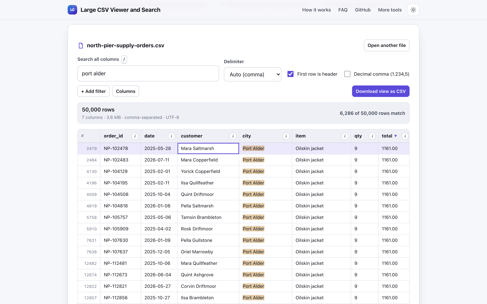
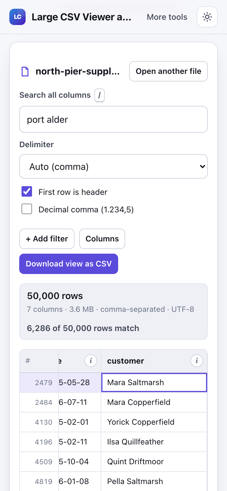

# Large CSV Viewer and Search

> Open big CSV files in your browser, sort, filter and search rows quickly, with nothing uploaded.

**🌐 Use it now: [turhe123.github.io/csv-viewer-local](https://turhe123.github.io/csv-viewer-local/)** · free · open source · runs in your browser · works offline


## Why

Large CSV Viewer and Search is a free, open-source alternative to online CSV viewers such as ConvertCSV Viewer and Datablist, which typically need an upload or an account, cap the free tier at a few thousand rows, or show ads, while Excel struggles with large CSV files. Here your files never leave the device, there is no account, no ads and no row limit, it works offline and it can be installed as an app.

## Screenshots

<p align="center"></p>

<p align="center"><em>Large CSV Viewer and Search in the browser, light theme</em></p>

<p align="center"></p>

<p align="center"><em>Large CSV Viewer and Search on a phone</em></p>

## Features

- Open a file by drag and drop or the file picker. Dropping a file onto an already open table replaces it.
- Parsing runs in a Web Worker in chunks, with a progress bar, so the page stays responsive.
- Automatic delimiter detection (comma, semicolon, tab, pipe) with a manual override.
- Automatic header-row detection with a "First row is header" toggle.
- Text encoding detection: strict UTF-8 first, falling back to Windows-1252. A byte order mark is stripped.
- Quoted line breaks inside cells are handled, and ragged rows are padded to the widest row.
- Virtualised table: only a small pool of row elements (about 60 or more) is rendered, so hundreds of thousands of rows scroll smoothly.
- Click a column header to sort; click again to reverse, and once more to return to the original order. Sorting is number-aware, ISO-date-aware and text-aware, and empty cells always go last.
- Decimal comma toggle for numbers such as `1.234,5`.
- Global search across all visible columns (150 ms debounce) with highlighted matches and a "N of M rows match" count.
- Per-column filters: contains, equals, is empty, is not empty. Several filters combine.
- Column picker to hide and show columns.
- Column details popover: type, distinct values, empty cells, min and max, with shortcuts to sort, filter or hide.
- Row detail drawer showing the full row as name and value pairs, handy on phones. Copy a cell or a whole row.
- Row numbers, a sticky header, and a stats line with row count, column count, file size, delimiter and encoding.
- Download the current filtered and sorted view as a new CSV (UTF-8 with BOM, CRLF line endings). The original file is never modified.
- Keyboard: `/` focuses search, arrow keys, Page Up/Down, Home and End move the selection, Enter opens the row, `Esc` clears the search or closes the drawer, `Ctrl`/`Cmd`+`C` copies the selected cell.
- Light and dark themes, responsive layout, installable as a PWA.

**Formats:** input is `.csv`, `.tsv`, `.tab`, `.txt`, `.psv` or `.dat` text files; output is CSV.

**Limits:** there is no row limit; the only bound is your device's memory, since all rows are held in memory as strings. For files over 300 MB you are warned and can preview just the first 100,000 rows. Very long cell text is shortened to 300 characters in the grid (the full value stays in the row drawer and in exports). Only one file is shown at a time. The tool is read-only: there is no editing.

## How to use

1. Open the page and drop a CSV, TSV or TXT file on it, or choose one with the file picker.
2. Check the detected delimiter and header row in the toolbar, and change them if needed.
3. Click column headers to sort, type in the search box (or press `/`), and use **+ Add filter** or the **Columns** panel to narrow things down.
4. Click any cell to read the whole row in the drawer, or press `Ctrl`/`Cmd`+`C` to copy the cell.
5. Press **Download view as CSV** to save the current filtered and sorted rows.

## Privacy

- Nothing is uploaded. Files are read and parsed on your device and never sent to a server.
- No cookies.
- Page views are counted anonymously with [GoatCounter](https://www.goatcounter.com/), which is cookieless and open source. No file contents are involved.
- It works offline: a service worker caches the page after the first visit.

## Run it locally

```sh
git clone https://github.com/turhe123/csv-viewer-local
cd csv-viewer-local
python3 -m http.server 4173
```

Then open http://127.0.0.1:4173/ in your browser. There is no build step.

## Tests

```sh
npm i -D @playwright/test && npx playwright install chromium
npx playwright test
```

## Third-party code

- [Papa Parse](https://www.papaparse.com/) 5.5.3, MIT license (`vendor/papaparse/`).

## Built with AI

Large CSV Viewer and Search was written by [Claude Code](https://claude.com/claude-code) inside an automated pipeline, from a plain-English spec. No code or assets from any commercial product were used; it is a clean-room implementation of a feature set, not a copy.

What that means in practice:

- The full source is in this repo under the MIT license. Read it before you trust it with your files.
- Everything runs in your browser. It makes no network requests except an anonymous, cookieless page-view count (GoatCounter); your files never leave the device.
- The page is tested headless in Chromium (Playwright) before every release, but it has had less human review than hand-written software. Bug reports and pull requests are welcome.

## Support ❤️

If this saved you time or a subscription, you can support the work on [Ko-fi](https://ko-fi.com/leodavidai).

## More free web tools

Find more free, private, in-browser tools at [turhe123.github.io/web-tools](https://turhe123.github.io/web-tools/).

## License

MIT © Or Davidai Bachar
